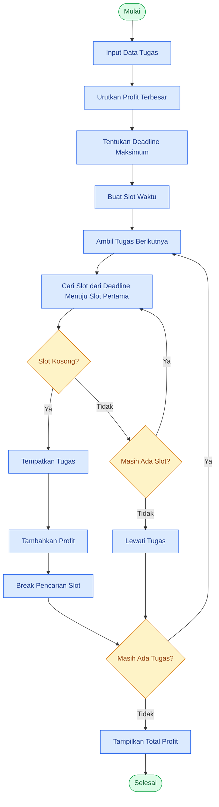

# 📅 Job Sequencing with Deadlines
### Penjadwalan Tugas Berdasarkan Keuntungan Menggunakan Greedy Algorithm

<p align="center">
  
  
  
</p>

> [!NOTE]
> **Fokus Pembelajaran**
>
> Memahami bagaimana algoritma Greedy memilih tugas berdasarkan profit terbesar, mengatur slot berdasarkan deadline, dan mencari slot kosong menggunakan iterasi mundur pada Python.

---

## 📚 Daftar Isi

- [01. Pengenalan Permasalahan](#-01-pengenalan-permasalahan)
- [02. Konsep Greedy Algorithm](#-02-konsep-greedy-algorithm)
- [03. Studi Kasus](#-03-studi-kasus)
- [04. Simulasi Penyelesaian](#-04-simulasi-penyelesaian)
- [05. Implementasi Python](#-05-implementasi-python)
- [06. Memahami Fungsi range()](#-06-memahami-fungsi-range-pada-python)
- [07. Perbedaan -1 pada range dan List](#-07-perbedaan--1-pada-range-dan-list-indexing)
- [08. Memahami Zero-Based Indexing](#-08-memahami-zero-based-indexing)
- [09. Analisis Kode Greedy](#-09-analisis-kode-greedy)
- [10. Flowchart](#-10-flowchart-algoritma)
- [11. Kompleksitas Algoritma](#-11-kompleksitas-algoritma)
- [12. Kesimpulan](#-12-kesimpulan)

---

# 🧩 01. Pengenalan Permasalahan

**Job Sequencing with Deadlines** merupakan permasalahan optimasi yang bertujuan memilih dan mengatur urutan pengerjaan tugas agar mendapatkan keuntungan (*profit*) semaksimal mungkin tanpa melewati batas waktu (*deadline*) setiap tugas.

Setiap tugas mempunyai tiga atribut utama:

| Atribut | Penjelasan |
|---|---|
| 🏷️ ID Tugas | Identitas setiap tugas |
| ⏰ Deadline | Batas waktu maksimal penyelesaian |
| 💰 Profit | Keuntungan jika tugas berhasil diselesaikan |

### 🎯 Tujuan

Memilih kombinasi tugas yang menghasilkan total keuntungan terbesar dengan tetap memperhatikan batas waktu yang tersedia.

### Asumsi dasar

- Setiap tugas membutuhkan waktu pengerjaan tepat **1 satuan waktu**.
- Satu slot hanya dapat digunakan untuk satu tugas.
- Tugas harus selesai sebelum atau tepat pada deadline.
- Profit hanya diperoleh jika tugas berhasil diselesaikan.
- Tugas yang tidak mempunyai slot tersedia akan dilewati.

> [!IMPORTANT]
> Asumsi durasi satu slot untuk setiap tugas sangat penting. Jika durasi tugas berbeda-beda, model penjadwalannya juga berbeda.

---

# 🧠 02. Konsep Greedy Algorithm

Greedy Algorithm merupakan algoritma yang mengambil keputusan terbaik pada setiap langkah berdasarkan strategi tertentu dengan harapan menghasilkan solusi optimal.

### Strategi yang digunakan

> **Pilih tugas dengan profit terbesar terlebih dahulu, kemudian tempatkan pada slot waktu paling akhir yang masih tersedia sebelum deadline.**

### ⚙️ Langkah kerja algoritma

1. Mengumpulkan seluruh data tugas.
2. Mengurutkan tugas berdasarkan profit terbesar ke terkecil.
3. Menentukan deadline maksimum sebagai jumlah slot waktu.
4. Memilih tugas berdasarkan urutan profit.
5. Mencari slot kosong dari deadline paling akhir menuju slot pertama.
6. Jika slot ditemukan, tempatkan tugas.
7. Jika tidak tersedia slot, lewati tugas.
8. Menghitung total profit seluruh tugas yang berhasil dijadwalkan.

### 💡 Mengapa memilih slot paling akhir?

Misalnya terdapat tugas dengan deadline 3.

| Slot 1 | Slot 2 | Slot 3 |
|:---:|:---:|:---:|
| Kosong | Kosong | Kosong |

Jika tugas ditempatkan pada slot 3, slot 1 dan 2 masih dapat digunakan oleh tugas lain yang memiliki deadline lebih awal.

Dengan demikian, kita mempertahankan fleksibilitas penjadwalan.

---

# 📊 03. Studi Kasus

Seorang freelancer memiliki lima tugas dari beberapa klien. Setiap tugas membutuhkan waktu pengerjaan tepat satu satuan waktu.

Freelancer ingin menentukan tugas mana yang harus dikerjakan agar mendapatkan keuntungan maksimal.

### Data tugas

| Tugas | Deadline | Profit |
|:---:|:---:|---:|
| A | 2 | 100 |
| B | 1 | 19 |
| C | 2 | 27 |
| D | 1 | 25 |
| E | 3 | 15 |

### Interpretasi

- **A:** Harus selesai paling lambat slot 2, profit 100.
- **B:** Harus selesai paling lambat slot 1, profit 19.
- **C:** Harus selesai paling lambat slot 2, profit 27.
- **D:** Harus selesai paling lambat slot 1, profit 25.
- **E:** Harus selesai paling lambat slot 3, profit 15.

### Menentukan jumlah slot

Deadline maksimum adalah 3.

```text
Jumlah slot = Deadline maksimum

Jumlah slot = 3
```

Dengan demikian, tersedia tiga slot waktu.

| Slot | Waktu |
|:---:|---|
| 1 | Waktu pertama |
| 2 | Waktu kedua |
| 3 | Waktu ketiga |

---

# 🔍 04. Simulasi Penyelesaian

## 4.1 Mengurutkan berdasarkan profit

Sebelum melakukan penjadwalan, seluruh tugas diurutkan dari profit terbesar ke terkecil.

| Prioritas | Tugas | Deadline | Profit |
|:---:|:---:|---:|---:|
| 1 | A | 2 | 100 |
| 2 | C | 2 | 27 |
| 3 | D | 1 | 25 |
| 4 | B | 1 | 19 |
| 5 | E | 3 | 15 |

## 4.2 Menentukan slot waktu

Karena deadline maksimum adalah 3, kita membutuhkan tiga slot.

```python
slots = [None, None, None]
```

Visualisasi:

| Indeks Python | Slot | Kondisi |
|:---:|:---:|---|
| 0 | Slot 1 | 🟢 Kosong |
| 1 | Slot 2 | 🟢 Kosong |
| 2 | Slot 3 | 🟢 Kosong |

> [!NOTE]
> Python menggunakan indeks yang dimulai dari 0, sedangkan penomoran slot waktu dimulai dari 1.

## 4.3 Proses penjadwalan

### 🥇 Tugas A

- Deadline: 2
- Profit: 100
- Indeks yang diperiksa: 1
- Slot 2 masih kosong.

**Keputusan:** Tugas A ditempatkan pada slot 2.

| Slot 1 | Slot 2 | Slot 3 |
|:---:|:---:|:---:|
| Kosong | **A (100)** | Kosong |

### 🥈 Tugas C

- Deadline: 2
- Profit: 27
- Periksa indeks 1 → sudah digunakan A.
- Mundur ke indeks 0 → masih kosong.

**Keputusan:** Tugas C ditempatkan pada slot 1.

| Slot 1 | Slot 2 | Slot 3 |
|:---:|:---:|:---:|
| **C (27)** | **A (100)** | Kosong |

### 🥉 Tugas D

- Deadline: 1
- Profit: 25
- Periksa indeks 0.
- Slot 1 sudah digunakan C.

**Keputusan:** Dilewati karena tidak tersedia slot.

### Tugas B

- Deadline: 1
- Profit: 19
- Periksa indeks 0.
- Slot 1 masih digunakan C.

**Keputusan:** Dilewati karena tidak tersedia slot.

### Tugas E

- Deadline: 3
- Profit: 15
- Periksa indeks 2.
- Slot 3 masih kosong.

**Keputusan:** Tugas E ditempatkan pada slot 3.

| Slot 1 | Slot 2 | Slot 3 |
|:---:|:---:|:---:|
| **C (27)** | **A (100)** | **E (15)** |

## 4.4 Hasil akhir — Gantt Chart

```text
       PENJADWALAN TUGAS

    SLOT 1    SLOT 2    SLOT 3
   ┌────────┬─────────┬────────┐
   │   C    │    A    │   E    │
   │   27   │   100   │   15   │
   └────────┴─────────┴────────┘

    0        1         2        3
             WAKTU
```

### 💰 Perhitungan total profit

```math
P_{\text{total}} = 27 + 100 + 15
```

```math
\boxed{P_{\text{total}} = 142}
```

<details>
<summary><strong>📌 Ringkasan keputusan setiap tugas</strong></summary>

| Tugas | Profit | Keputusan |
|:---:|---:|---|
| A | 100 | ✅ Dipilih |
| C | 27 | ✅ Dipilih |
| D | 25 | ❌ Dilewati |
| B | 19 | ❌ Dilewati |
| E | 15 | ✅ Dipilih |

Total tugas terjadwal: **3 dari 5**.

Total profit: **142**.

</details>

---

# 🐍 05. Implementasi Python

Berikut implementasi algoritma Greedy berdasarkan studi kasus sebelumnya.

### Source Code

```python
# ==========================================
# JOB SEQUENCING WITH DEADLINES
# GREEDY ALGORITHM
# ==========================================

# 1. Data tugas
jobs = [
    {"id": "A", "deadline": 2, "profit": 100},
    {"id": "B", "deadline": 1, "profit": 19},
    {"id": "C", "deadline": 2, "profit": 27},
    {"id": "D", "deadline": 1, "profit": 25},
    {"id": "E", "deadline": 3, "profit": 15}
]

# 2. Urutkan berdasarkan profit terbesar
jobs.sort(
    key=lambda x: x["profit"],
    reverse=True
)

# 3. Tentukan deadline maksimum
max_deadline = max(
    job["deadline"] for job in jobs
)

# 4. Buat slot waktu
slots = [None] * max_deadline

total_profit = 0

# 5. Proses Greedy
for job in jobs:

    # Cari slot dari deadline paling akhir
    # menuju slot pertama
    for slot in range(
        job["deadline"] - 1, -1, -1
    ):

        # Periksa apakah slot masih kosong
        if slots[slot] is None:

            # Tempatkan tugas
            slots[slot] = job

            # Tambahkan profit
            total_profit += job["profit"]

            # Hentikan pencarian slot
            break

# 6. Tampilkan hasil
print("=== JADWAL TUGAS ===")

for i, job in enumerate(slots):

    if job is not None:
        print(
            f"Slot {i+1}: Tugas {job['id']} "
            f"(Profit: {job['profit']})"
        )

    else:
        print(f"Slot {i+1}: Kosong")

print("====================")
print("Total Profit:", total_profit)
```

### Output program

```text
=== JADWAL TUGAS ===
Slot 1: Tugas C (Profit: 27)
Slot 2: Tugas A (Profit: 100)
Slot 3: Tugas E (Profit: 15)
====================
Total Profit: 142
```

> [!TIP]
> Cobalah mengubah nilai profit dan deadline untuk melihat bagaimana algoritma Greedy menghasilkan jadwal yang berbeda.

---

# 🔄 06. Memahami Fungsi range() pada Python

Bagian penting dari implementasi Greedy adalah:

```python
for slot in range(
    job["deadline"] - 1, -1, -1
):
```

Bagian ini bertanggung jawab mencari slot kosong dengan melakukan iterasi dari indeks paling akhir menuju indeks pertama.

## 6.1 Format range()

```python
range(start, stop, step)
```

| Parameter | Fungsi |
|---|---|
| `start` | Nilai awal iterasi |
| `stop` | Batas berhenti, tidak termasuk nilainya |
| `step` | Perubahan nilai setiap iterasi |

### Contoh iterasi maju

```python
range(0, 5, 1)
```

Hasil:

```text
0 → 1 → 2 → 3 → 4
```

### Contoh iterasi mundur

```python
range(4, -1, -1)
```

Hasil:

```text
4 → 3 → 2 → 1 → 0
```

## 6.2 Mengapa menggunakan range(2, -1, -1)?

Artinya:

| Parameter | Nilai | Makna |
|---|---:|---|
| Start | 2 | Mulai dari indeks 2 |
| Stop | -1 | Berhenti sebelum -1 |
| Step | -1 | Mundur satu angka |

Proses iterasi:

```text
2 → 1 → 0 → berhenti
```

| Iterasi | Nilai `slot` | Status |
|:---:|:---:|---|
| 1 | 2 | ✅ Dieksekusi |
| 2 | 1 | ✅ Dieksekusi |
| 3 | 0 | ✅ Dieksekusi |
| 4 | -1 | ⛔ Tidak dieksekusi |

### 💡 Mengapa stop menggunakan -1?

Karena `stop` bersifat eksklusif.

Jika kita menggunakan:

```python
range(2, 0, -1)
```

Hasilnya:

```text
2 → 1
```

Indeks 0 tidak ikut diperiksa.

Oleh karena itu:

```python
range(2, -1, -1)
```

Digunakan agar iterasi mencakup indeks 0.

> [!IMPORTANT]
> `-1` sebagai batas berhenti bukan berarti Python langsung berhenti karena angkanya negatif. Python tetap menghasilkan 2, 1, dan 0 sesuai arah iterasi yang ditentukan oleh `step = -1`.

---

# 🔢 07. Perbedaan -1 pada range dan List Indexing

Angka `-1` dapat mempunyai arti berbeda bergantung pada konteks penggunaannya.

## 7.1 -1 sebagai indeks list

Python mendukung indeks negatif untuk mengakses elemen list dari belakang.

```python
slots = ["A", "B", "C"]

print(slots[-1])
```

Output:

```text
C
```

Visualisasi:

| Indeks positif | Indeks negatif | Nilai |
|:---:|:---:|:---:|
| 0 | -3 | A |
| 1 | -2 | B |
| 2 | -1 | C |

Artinya:

- `slots[0]` → elemen pertama.
- `slots[1]` → elemen kedua.
- `slots[2]` → elemen ketiga.
- `slots[-1]` → elemen terakhir.
- `slots[-2]` → elemen kedua dari belakang.

## 7.2 -1 sebagai batas range()

```python
range(2, -1, -1)
```

Hasil:

```text
2 → 1 → 0
```

Angka -1 tidak ikut dijalankan karena merupakan batas berhenti.

## 7.3 Perbandingan

| Penulisan | Makna |
|---|---|
| `slots[-1]` | Mengakses elemen terakhir |
| `range(2, -1, -1)` | Menghasilkan 2, 1, 0 |
| `range(2, 0, -1)` | Menghasilkan 2, 1 |
| `range(2, -2, -1)` | Menghasilkan 2, 1, 0, -1 |

> [!WARNING]
> Jangan menyamakan `-1` sebagai indeks list dengan `-1` sebagai batas `range()`. Keduanya memiliki fungsi berbeda.

---

# 📍 08. Memahami Zero-Based Indexing

Python menggunakan sistem **Zero-Based Indexing**, yaitu penomoran indeks dimulai dari angka 0.

Contoh:

```python
slots = [None, None, None]
```

| Indeks Python | Posisi Slot | Nilai |
|:---:|---|---|
| 0 | Slot 1 | None |
| 1 | Slot 2 | None |
| 2 | Slot 3 | None |

### Mengapa deadline harus dikurangi 1?

Misalnya deadline sebuah tugas adalah 3.

Slot yang dapat digunakan:

```text
Slot 1 → Index 0
Slot 2 → Index 1
Slot 3 → Index 2
```

Sehingga:

```math
\text{Index Maksimum} = \text{Deadline} - 1
```

```math
3 - 1 = 2
```

Maka kode berikut:

```python
job["deadline"] - 1
```

Mengubah nilai deadline menjadi indeks list yang sesuai.

---

# ⚙️ 09. Analisis Kode Greedy

Mari kita pecah bagian inti algoritma menjadi enam bagian.

## 09.1 Menentukan awal pencarian

```python
job["deadline"] - 1
```

Mengubah deadline menjadi indeks list Python.

Contoh:

```text
Deadline = 3
Index awal = 2
```

## 09.2 Melakukan iterasi mundur

```python
range(job["deadline"] - 1, -1, -1)
```

Memeriksa slot dari indeks paling akhir menuju indeks 0.

```text
2 → 1 → 0
```

## 09.3 Memeriksa apakah slot kosong

```python
if slots[slot] is None:
```

Artinya memeriksa apakah slot pada indeks saat ini belum digunakan.

`None` menunjukkan bahwa slot belum memiliki tugas.

## 09.4 Menempatkan tugas

```python
slots[slot] = job
```

Jika slot masih kosong, masukkan tugas ke dalam slot tersebut.

## 09.5 Menghitung profit

```python
total_profit += job["profit"]
```

Tambahkan profit tugas yang berhasil dijadwalkan ke total keuntungan.

## 09.6 Menghentikan pencarian

```python
break
```

Menghentikan perulangan pencarian slot setelah tugas berhasil ditempatkan.

Mengapa menggunakan `break`?

Karena setiap tugas hanya membutuhkan satu slot waktu. Setelah mendapatkan satu slot yang sesuai, kita tidak perlu mencari slot lainnya.

Jika tidak ada slot yang tersedia sampai indeks 0, perulangan selesai secara alami dan tugas dilewati.

---

# 🗺️ 10. Flowchart Algoritma

Berikut gambaran alur penyelesaian Job Sequencing menggunakan Greedy.



---

# 📈 11. Kompleksitas Algoritma

Misalkan:

- `n` = jumlah seluruh tugas.
- `D` = deadline maksimum.

### Kompleksitas waktu

| Proses | Kompleksitas |
|---|---|
| Mengurutkan tugas | O(n log n) |
| Membuat slot waktu | O(D) |
| Mencari slot kosong | O(nD) |

Total kompleksitas waktu:

```math
O(n \log n + D + nD)
```

Kompleksitas dominannya:

```math
\boxed{O(n \log n + nD)}
```

### Kompleksitas ruang

Penyimpanan slot membutuhkan ruang sebanyak deadline maksimum, yaitu O(D).

Jika daftar tugas juga dihitung sebagai input yang disimpan, ruang totalnya O(n + D).

> [!NOTE]
> Untuk jumlah tugas dan deadline yang besar, pencarian slot satu per satu dapat menjadi kurang efisien. Optimasi menggunakan Disjoint Set Union (DSU) dapat dipertimbangkan.

---

# 🎓 12. Kesimpulan

Job Sequencing with Deadlines merupakan permasalahan optimasi yang dapat diselesaikan menggunakan Greedy Algorithm dengan asumsi setiap tugas memiliki durasi satu slot waktu.

### Inti strategi

1. Mengurutkan tugas berdasarkan profit terbesar.
2. Memilih tugas dengan profit terbesar terlebih dahulu.
3. Memeriksa slot waktu dari deadline paling akhir menuju slot pertama.
4. Menempatkan tugas pada slot kosong paling akhir.
5. Melewati tugas apabila tidak tersedia slot yang memenuhi deadline.

### Hasil studi kasus

| Keterangan | Hasil |
|---|---:|
| Jumlah tugas awal | 5 |
| Tugas berhasil dijadwalkan | 3 |
| Total profit | **142** |

```math
\boxed{27 + 100 + 15 = 142}
```

### 🧠 Hal penting yang harus diingat

| Konsep | Inti pemahaman |
|---|---|
| Greedy Algorithm | Memilih keputusan terbaik berdasarkan strategi lokal |
| Profit | Keuntungan dari tugas yang berhasil diselesaikan |
| Deadline | Batas waktu maksimal penyelesaian |
| Slot | Tempat untuk menjadwalkan satu tugas |
| `range()` | Menghasilkan urutan angka untuk iterasi |
| `start` | Nilai awal iterasi |
| `stop` | Batas berhenti yang tidak ikut dieksekusi |
| `step` | Perubahan nilai setiap iterasi |
| `-1` pada range | Dapat menjadi batas berhenti iterasi mundur |
| `-1` pada list | Mengakses elemen terakhir |
| Zero-based indexing | Indeks list dimulai dari 0 |
| `break` | Menghentikan perulangan |
| `None` | Menandakan slot masih kosong |

---

## 🚀 Prinsip Utama

> Greedy memilih tugas dengan keuntungan terbesar terlebih dahulu, kemudian mencari slot paling akhir yang masih memenuhi deadline agar kesempatan penjadwalan tugas lainnya tetap terjaga.

**Jangan hanya menghafalkan kode.** Pahami hubungan antara deadline, indeks list, arah iterasi, kondisi slot kosong, dan alasan penggunaan `break`.

Dengan memahami hubungan tersebut, kamu akan lebih mudah membangun algoritma penjadwalan secara mandiri.

---

<p align="center">
  <strong>END OF NOTES</strong>
  <br/>
  <sub>Algorithm & Data Structures — Greedy Algorithm</sub>
</p>